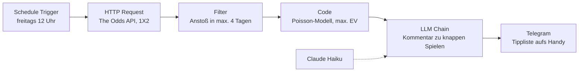

# Kicktipp-Agent

KI-gestützter n8n-Workflow für eine private Kicktipp-Runde. Die Automation holt jeden Freitag um 12 Uhr die aktuellen Bundesliga-Quoten, berechnet für jedes Spiel das exakte Ergebnis mit den meisten erwarteten Punkten und schickt die Tippliste mit einem kurzen KI-Kommentar per Telegram an den Nutzer.


## Ablauf



## Das Modell

Der Code `src/tipps_berechnen.js` berechnet
1. **Faire Wahrscheinlichkeiten:** Mittelwert der Quoten aller Buchmacher.
2. **Torerwartung:** Erwartete Toranzahl wird berechnet
3. **Ergebnisverteilung:** Erstellt die Wahrscheinlichkeiten von jedem Ergebniss von 0:0 bis 9:9.
4. **Bester Tipp:** Erwartete Punkte jedes Tipps von 0:0 bis 6:6 unter dem Punkteschema der Runde (4 exakt / 3 Tordifferenz / 2 Tendenz). Der höchste Erwartungswert gewinnt.


## Setup

1. n8n per Docker starten:
   ```bash
   docker volume create n8n_data
   docker run -d --name n8n --restart unless-stopped -p 5678:5678 \
     -e GENERIC_TIMEZONE="Europe/Berlin" -e TZ="Europe/Berlin" \
     -v n8n_data:/home/node/.n8n docker.n8n.io/n8nio/n8n
   ```
2. In n8n `workflow/kicktipp-agent.json` importieren („…“ → „Import from File“).
3. Credentials anlegen:
   - **Quoten abrufen:** Query Auth, Name `apiKey`, Value = Key von [the-odds-api.com](https://the-odds-api.com/)
   - **Claude:** Anthropic-Credential mit eigenem API-Key
   - **Telegram senden:** Bot-Token von `@BotFather`, dazu die eigene Chat-ID statt `DEINE_CHAT_ID`
4. Workflow aktivieren.

## Hinweis

Privates Lernprojekt für ein Tippspiel unter Freunden. Keine Wettempfehlung.
