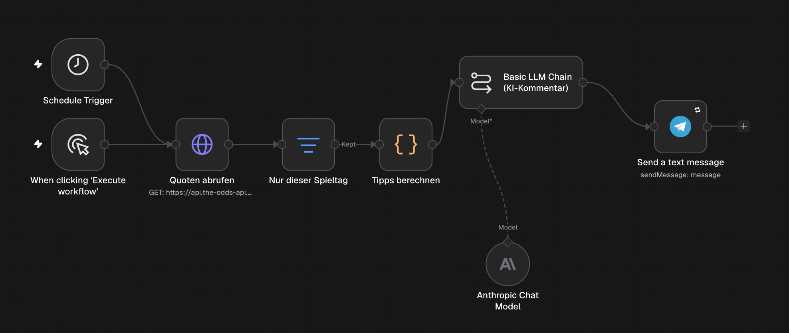
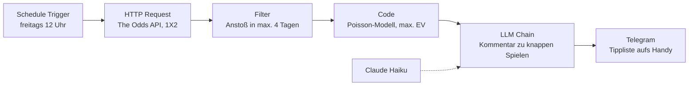

# Kicktipp-Agent

KI-gestützter n8n-Workflow für eine private Kicktipp-Runde: Jeden Freitag um 12 Uhr holt er die aktuellen Bundesliga-Quoten, berechnet für jedes Spiel das exakte Ergebnis mit den meisten erwarteten Punkten und schickt die Tippliste mit einem kurzen KI-Kommentar per Telegram.



## Ablauf



## Das Modell

Der Code-Node `src/tipps_berechnen.js` rechnet in vier Schritten:

1. **Faire Wahrscheinlichkeiten:** Kehrwerte der 1X2-Quoten, Buchmachermarge herausgerechnet, über alle Buchmacher gemittelt.
2. **Torerwartung:** Erwartete Tore je Team werden so gesucht, dass ein Poisson-Modell mit Dixon-Coles-Korrektur die Marktwahrscheinlichkeiten für Heimsieg, Remis und Auswärtssieg trifft.
3. **Ergebnisverteilung:** Wahrscheinlichkeit jedes Ergebnisses von 0:0 bis 9:9.
4. **Bester Tipp:** Erwartete Punkte jedes Tipps von 0:0 bis 6:6 unter dem Punkteschema der Runde (4 exakt / 3 Tordifferenz / 2 Tendenz). Der höchste Erwartungswert gewinnt.

## Designentscheidungen

- **Die KI rechnet nicht.** Sprachmodelle rechnen unzuverlässig und nicht reproduzierbar. Die Mathematik läuft deterministisch im Code, das LLM formuliert nur einen kurzen Hinweis zu knappen Entscheidungen und darf keinen Tipp ändern.
- **Quoten statt eigener Statistik.** Buchmacherquoten sind die beste öffentlich verfügbare Prognose. Das Modell übersetzt sie nur in das Punkteschema der Runde.
- **Keine Ergebnisquoten.** Der Markt auf das genaue Ergebnis hat eine deutlich höhere Marge und verzerrt gerade die häufigen Ergebnisse. Die Verteilung aus dem 1X2-Markt ist die bessere Grundlage.
- **Workflow statt Agent.** Die Schritte sind fest vorgegeben, weil eine wöchentliche Routine robust laufen soll.

## Setup

1. n8n per Docker starten:
   ```bash
   docker volume create n8n_data
   docker run -d --name n8n --restart unless-stopped -p 5678:5678 \
     -e GENERIC_TIMEZONE="Europe/Berlin" -e TZ="Europe/Berlin" \
     -v n8n_data:/home/node/.n8n docker.n8n.io/n8nio/n8n
   ```
2. In n8n `workflow/kicktipp-agent.json` importieren („…“ → „Import from File“).
3. Credentials anlegen:
   - **Quoten abrufen:** Query Auth, Name `apiKey`, Value = Key von [the-odds-api.com](https://the-odds-api.com/)
   - **Claude:** Anthropic-Credential mit eigenem API-Key
   - **Telegram senden:** Bot-Token von `@BotFather`, dazu die eigene Chat-ID statt `DEINE_CHAT_ID`
4. Workflow aktivieren.

## Grenzen

- Freitagsquoten sind für die Sonntagsspiele noch nicht final; Aufstellungen kennt das Modell nicht.
- Ohne Über/Unter-Quoten wird das Torniveau aus der Remis-Wahrscheinlichkeit geschätzt.
- In englischen Wochen muss der Workflow manuell gestartet werden.

## Hinweis

Privates Lernprojekt für ein Tippspiel unter Freunden. Keine Wettempfehlung.
